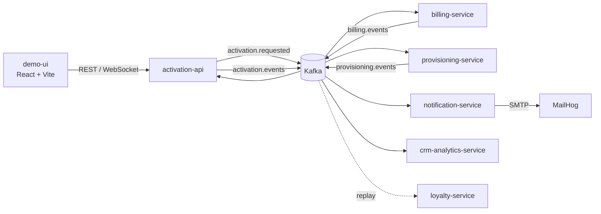

# Activación de Servicios con Kafka — POC de microservicios

Trabajo práctico 6 · Programación Avanzada 2026 · Licenciatura en Sistemas de Información (FCyT, UADER)
**Autora:** Melina Mas Duarte

Prueba de concepto de un flujo de **activación de un plan** (como el de una empresa de telecomunicaciones)
coordinado únicamente por eventos. Cuando un cliente contrata un plan, varios microservicios reaccionan
por su cuenta: facturación crea la cuenta, aprovisionamiento da de alta el servicio, notificaciones envía
el email y analítica registra todo. Si algún paso falla, la saga **compensa** lo ya hecho, sin que ningún
servicio llame directamente a otro.

**Stack:** NestJS · Apache Kafka (modo KRaft) · MongoDB (una base por servicio) · React + Vite + TypeScript
· Docker Compose · MailHog · Kafka UI

---

## Qué demuestra

| Concepto | Cómo se implementa |
|---|---|
| **Saga coreografiada con compensación** | Si facturación o aprovisionamiento fallan, `activation-api` publica `ActivationFailed` y `billing-service` cancela la cuenta creada. |
| **Idempotencia** | Cada servicio guarda los `eventId` procesados (índice único + TTL de 7 días). El chequeo, el efecto de negocio y la publicación corren en una transacción de MongoDB. |
| **Reintentos y Dead Letter Queue** | Decorador `@RetryWithDlq`: 3 reintentos con backoff exponencial (1s, 2s, 4s) y, si sigue fallando, el mensaje va a `<topic>.dlq` sin bloquear la partición. |
| **Orden por cliente** | Todos los eventos usan `customerId` como key, así que los de un mismo cliente caen en la misma partición. |
| **Escalabilidad horizontal** | Topics de 3 particiones y consumer groups. `billing-service` se puede escalar con `--scale`. |
| **Replay del log** | `loyalty-service` arranca tarde, lee desde `earliest` y reconstruye su estado con todo el historial. |

## Arquitectura



Cada servicio tiene su propia base MongoDB y ninguno lee la base de otro.
El detalle completo (topics, sobre del evento, diagrama de secuencia) está en
[`activation-poc/docs/architecture.md`](activation-poc/docs/architecture.md).

## Cómo ejecutarlo

Requisito: Docker Desktop (o Docker Engine + Compose v2).

```bash
cd activation-poc
docker compose up -d --build
```

| URL | Qué es |
|---|---|
| http://localhost:5173 | Demo UI: contratar un plan y ver la línea de tiempo de eventos |
| http://localhost:8080 | Kafka UI: topics, mensajes, DLQ y consumer groups |
| http://localhost:8025 | MailHog: emails enviados por `notification-service` |
| http://localhost:3000 | API (`POST /activations`, `GET /activations/:id`) |

Para levantar también el consumidor tardío: `docker compose --profile loyalty up -d loyalty-service`.
Para empezar de cero: `docker compose down -v`.

Ejemplo de activación por API:

```bash
curl -X POST http://localhost:3000/activations -H "Content-Type: application/json" \
  -d '{"customerId":"C-1001","planId":"PLAN_DIGITAL","simulateFailure":"none"}'
```

`simulateFailure` acepta `none`, `billing`, `provisioning` (fallos de negocio que disparan la compensación)
y `dlq` (fallo técnico que termina en la DLQ).

## Demo

El guion [`activation-poc/docs/demo-script.md`](activation-poc/docs/demo-script.md) recorre cinco escenarios
en unos 15 minutos:

1. **Camino feliz**: un evento, varias reacciones (fan-out).
2. **Fallo y compensación**: la saga deshace los pasos sin llamadas directas.
3. **Servicio caído**: gracias al offset, ningún mensaje se pierde.
4. **Escalar**: consumer groups y particiones.
5. **Nuevo consumidor**: replay del log desde el inicio.

## Estructura

```
activation-poc/
├── apps/
│   ├── activation-api/         # API REST + WebSocket, orquesta el estado de la activación
│   ├── billing-service/        # Cuenta de facturación (y su compensación)
│   ├── provisioning-service/   # Alta técnica del servicio
│   ├── notification-service/   # Emails vía SMTP (MailHog)
│   ├── crm-analytics-service/  # Registro de todos los eventos
│   ├── loyalty-service/        # Consumidor tardío (replay)
│   └── demo-ui/                # Interfaz React para la demo
├── libs/
│   ├── contracts/              # Tipos y sobre común de los eventos
│   └── kafka-toolkit/          # Idempotencia, reintentos/DLQ y opciones de consumidor
├── docker/                     # Dockerfiles y script de creación de topics
├── docs/                       # Arquitectura y guion de demo
└── docker-compose.yml
```
